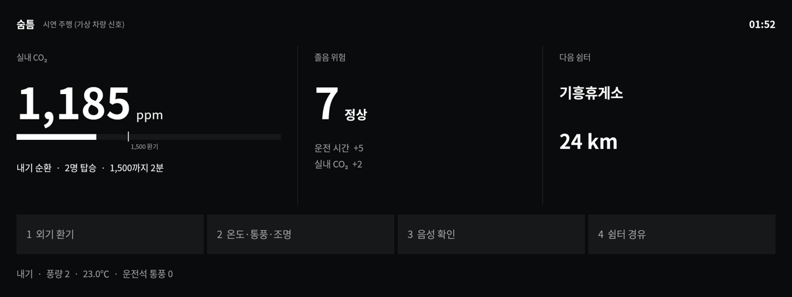
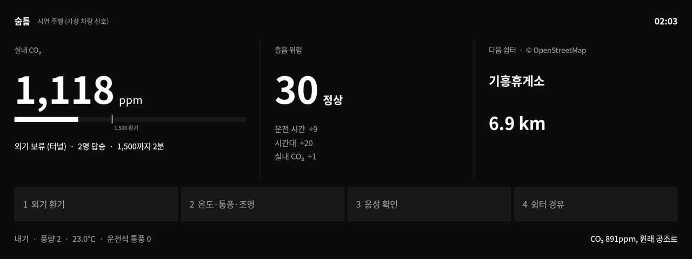
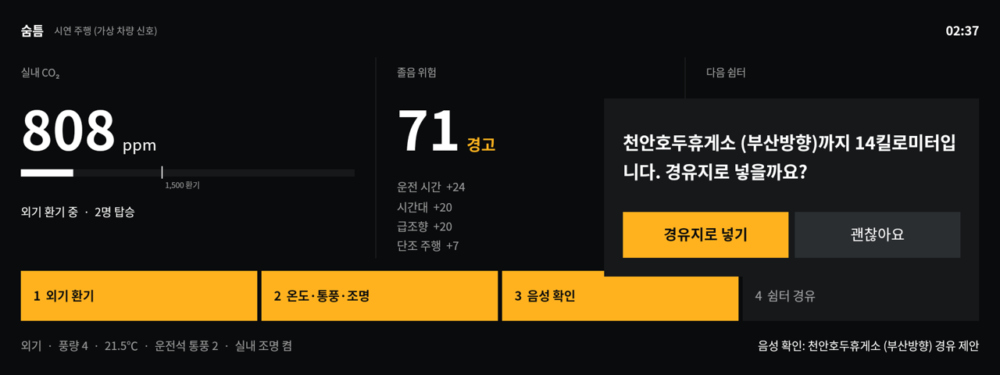
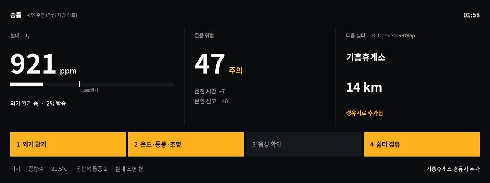

# 숨틈 (Sumteum)

**졸음 신호가 나오기 전에 실내 공기부터 바꾸는 Pleos Connect 졸음운전 예방 앱**

창을 닫고 내기 순환으로 달리면 두 사람이 탄 차의 이산화탄소(CO₂)는 30분 만에 600ppm에서 5,000ppm을 넘깁니다(한국도로공사 실차 측정). 숨틈은 CO₂ 센서 없이 좌석 착좌·내외기·풍량·주행 시간으로 실내 CO₂를 계산해 1,500ppm에서 외기를 짧게 엽니다. 졸음 위험이 오르면 경고음 대신 공조·시트·조명을 직접 바꾸고 그래도 높으면 음성으로 물어 다음 쉼터를 경유지로 넣습니다.

| 주행 중 | 터널 구간 |
|---|---|
|  |  |
| **음성 확인** | **Gleo 「나 졸려」** |
|  |  |

## APK

- 파일: `Arka_Sumteum_release.apk` (release 서명, arm64-v8a·x86_64)
- 위치: [GitHub Release v1.0.0](https://github.com/Arcosium/sumteum/releases/tag/v1.0.0)
- 시연 영상: 같은 Release의 `Sumteum_demo.mp4` (1분 39초, 시연 주행 화면 녹화와 Gleo 호출)
- APK가 24MB라 저장소 폴더 대신 Release에 올렸습니다. 대부분은 Pleos 음성 SDK(TextToSpeech·SpeechToText)가 함께 넣는 보안 라이브러리입니다.

## 실행 방법

### Pleos Connect Emulator에서 (차량 모드)

1. Pleos Connect Emulator v2.1.0(API 34) AVD를 띄웁니다.
2. 설치하고 실행합니다.
   ```bash
   adb install -r -g Arka_Sumteum_release.apk
   adb shell am start -n com.arka.sumteum/.MainActivity
   ```
3. 앱은 Pleos 차량 서비스를 찾으면 차량 모드로, 없으면 시연 주행으로 시작합니다.
4. Virtual Console(`adb forward tcp:8088 tcp:8088` 뒤 `http://127.0.0.1:8088/`)에서 아래 값을 바꾸면 화면이 따라 움직입니다.

| Virtual Console | 숨틈에서 쓰는 곳 |
|---|---|
| Convenience: 좌석 착좌 | 탑승 인원, CO₂ 발생량 |
| Climate: 내기순환·풍량 | 환기량. 앱이 외기 전환·풍량·온도·좌석 통풍을 직접 바꿈 |
| Motion: 기어 | D단이면 운전 시간을 셈 |
| Motion: 스티어링 휠 각도 | 1.5초 안에 15° 넘게 꺾인 급조향(방향지시등 없이) |
| Convenience: 방향지시등 | 차로 변경 여부, 단조 주행 시간 |

### 시연 주행 (Pleos 차량이 없는 Android 기기)

```bash
adb shell am start -n com.arka.sumteum/.MainActivity --ez demo true
```

새벽 01:50 양재IC에서 대전 방향으로 두 사람이 내기 순환으로 달리는 상황을 30배속으로 재생합니다(약 2분 30초). 각본은 차량 신호만 정합니다. 환기·단계 상승·쉼터 선택은 차량 모드와 같은 엔진이 판단합니다. 경로는 경부고속도로 실제 도로 형상이고 쉼터는 OpenStreetMap 실제 좌표입니다. 화면 위에 「시연 주행 (가상 차량 신호)」이 표시됩니다.

### Gleo AI 음성 호출 시험

`app/src/main/assets/schema.json`에 함수 3개를 등록했습니다(Gleo Interface, component `service`).

| 함수 | 말 예시 | 하는 일 |
|---|---|---|
| `VENTILATE_CABIN` | 「환기해 줘」 | 외기 환기 뒤 원래 공조로 복귀. 터널 등 외기 보류 중이면 `fail` |
| `ADD_REST_STOP` | 「쉬었다 가자」 | 앞쪽 쉼터를 경유지로 추가 |
| `REPORT_DROWSINESS` | 「나 졸려」 | 환기·온도·통풍·조명·경유지를 한 번에 실행 |

Gleo 없이도 같은 방송으로 시험할 수 있습니다. 응답(콜백 JSON)은 `ai.pleos.playground.intent.action.APP_ACTION_RESPONSE`로 나가고 logcat `Gleo` 태그에도 찍힙니다.

```bash
adb shell am broadcast -a REPORT_DROWSINESS -p com.arka.sumteum
adb logcat -s Gleo:I
```

## 테스트 환경

| 항목 | 내용 |
|---|---|
| 빌드 | JDK 17, Gradle 8.10.2, AGP 8.5.0, Kotlin 1.9.24, compileSdk 34, minSdk 28 |
| Pleos SDK | Vehicle 2.3.2, NaviHelper 3.0.5, TextToSpeech 3.3.1, SpeechToText 3.3.1 (`https://nexus-playground.pleos.ai/repository/maven-releases/`) |
| 단위 테스트 | `./gradlew :app:testDebugUnitTest` 8개 (CO₂ 모델 실측 재현, 위험 점수, 급조향, 쉼터 방향·경로, 환기·터널, 개입 사다리) |
| 실행 확인 | Android 14 arm64, 1920×720 화면에서 시연 주행 전 과정과 Gleo 방송 호출 |
| 권한 | 읽기 `CAR_SEATS`·`CAR_CLIMATE`·`CAR_DRIVE`·`CAR_LIGHTS`, 제어 `CONTROL_CAR_CLIMATE`·`CONTROL_CAR_SEATS`·`CONTROL_CAR_LIGHTS`, `RECORD_AUDIO` |

제어 권한(`CONTROL_CAR_*`)은 Pleos App Market과 협의해 승인받아야 하는 권한입니다. 승인 전에는 공조·시트·조명 변경이 거부될 수 있고 그때도 CO₂ 계산·위험 점수·음성 확인·경유지 추가는 동작합니다.

## 빌드

```bash
./gradlew :app:assembleRelease
```

`keystore.properties`가 없으면 release 빌드는 디버그 키로 서명됩니다.

## 구조

```
app/src/main/java/com/arka/sumteum/
  core/Model.kt      CO₂ 물질수지 모델, 졸음 위험 점수
  core/Steering.kt   방향지시등 없는 급조향, 단조 주행 시간
  core/Engine.kt     예방층(1,500ppm 환기)과 4단계 개입 사다리
  core/RestStops.kt  진행 방향·경로 위 쉼터 찾기
  car/PleosCarLink.kt  Pleos Vehicle·NaviHelper·TTS·STT 연결
  car/DemoCarLink.kt   시연 주행(차량 신호만 재생)
  Hub.kt             엔진 실행(포그라운드 서비스), Gleo 함수 처리
  GleoReceiver.kt    Gleo 호출 수신과 콜백
```

## 계산 근거

- **CO₂:** 실내 3.0m³, 성인 1명 0.0052L/s, 외기 600ppm, 내기 순환 환기 횟수 1.2회/시. 두 사람이면 30분 뒤 약 5,300ppm으로 한국도로공사 실차 측정(600 → 5,000ppm 이상)과 맞습니다. 2,000ppm까지 1명 15.7분, 2명 7.2분, 4명 3.5분입니다. 외기 모드 환기량은 풍량 단계에 비례한다고 가정했고 차종별 보정이 필요합니다.
- **졸음 위험(0~100):** 운전 시간(1시간부터 2시간까지 0→25), 시간대(02~05시 20, 14~15시 10), 실내 CO₂(1,000→2,500ppm 0→20), 5분 안 급조향(1회 8, 최대 20), 방향지시등 없는 주행(20→60분 0→15), 본인 신고 40. 40에서 외기 환기, 55에서 온도·통풍·조명, 70에서 음성 확인을 하고 80부터 「위험」으로 표시합니다.
- **쉼터:** 경로를 알면 도로에서 600m 안의 쉼터를 도로 거리로, 모르면 진행 방향 ±60°를 직선거리로 찾습니다. 「(서울방향)」처럼 행선지가 적힌 시설은 그 도시가 진행 방향 쪽일 때만 고릅니다. 음성으로 제안하는 쉼터는 3km 이상 남은 곳입니다.

숨틈은 졸음을 진단하지 않습니다. 이미 알려진 위험 요인(긴 운전, 새벽 시간대, 높은 CO₂, 급조향)을 줄이는 쪽으로 차를 움직입니다.

## 데이터 출처

- 졸음쉼터·휴게소 좌표: © OpenStreetMap contributors, [ODbL](https://opendatacommons.org/licenses/odbl/) (2026-10-28 수집, 이름에 휴게소·쉼터가 있는 1,150곳)
- 시연 경로: OSRM 경로 탐색(OpenStreetMap 기반) 양재IC → 대전IC
- 글꼴: Noto Sans KR (SIL Open Font License), 앱에 쓰는 글자만 남긴 부분 집합(`tools/subset_fonts.py`)

## 팀

Arka
